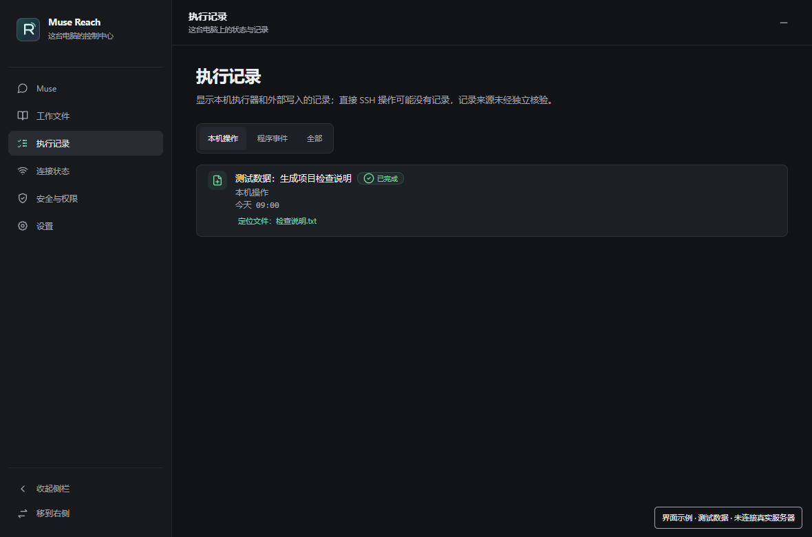
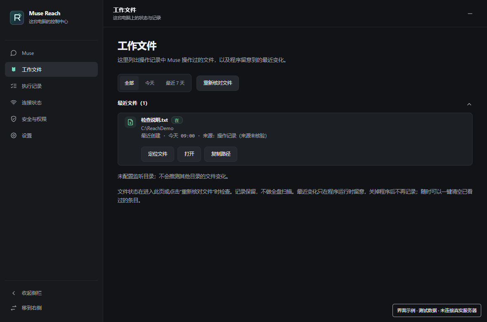
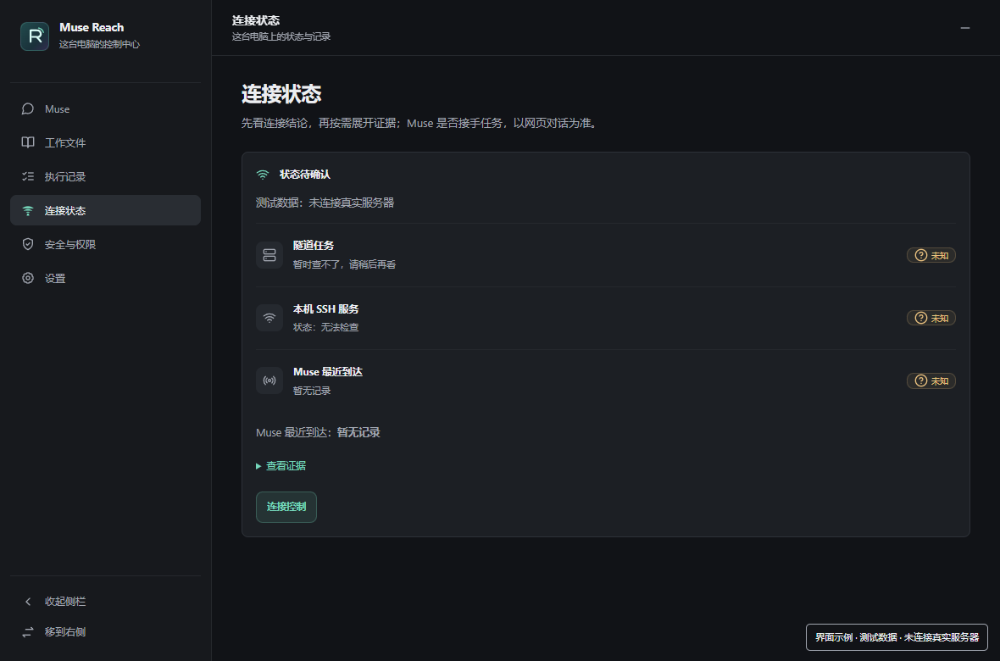

# Muse Reach

本地 Agent：云端负责想，本地负责做。

Reach 是一个跑在你 Windows 电脑上的本地 Agent（C# + .NET 8 WinForms + WebView2）。它像 Codex 一样长在机器上：任务交进来，就在本机跑命令、动文件、改配置、看日志、验结果、留记录。区别只是 Codex 的战场是代码仓库，Reach 的战场是整台电脑；对话本身走内嵌的 muse.ai 网页，动手的是本机这个程序。

一句话：云端只负责想，本地负责做。把 Reach 关掉，剩下的只是一个会聊天的网页。

当前版本：v47。

## 功能

- **Muse**：内嵌 muse.ai 网页对话，可把一条对话设为主对话，下次打开直接进入。
- **工作文件**：只列出操作记录中已确认由 Muse 操作过的文件；程序运行时留意到的文件变化会先列为「未确认变化」，等你确认或忽略。
- **执行记录**：本机操作一行一条，相对时间、人话摘要、结果一目了然；程序日志单独折叠；原始命令默认隐藏。
- **连接状态**：三层检查（隧道任务 / 本机 SSH 服务 / Muse 最近到达），每层状态用形状＋颜色共同区分。
- **安全与权限**：连接与权限的真实边界，不假装能限制做不到的事。
- **设置**：托盘、开机启动、全局热键、界面主题（9 套）、网页缩放、动效开关。
- **界面**：细线条图标（Lucide 风格），悬停有轻微动效；侧栏可收起、可换边；窗口位置与大小会记住。

## 服务器

Reach 不直连云端，中间经过一台你自己的中转服务器。服务器只做三件事：

1. **中转**：笔记本主动向服务器打一条反向 SSH 隧道，云端经服务器跳进笔记本。笔记本不需要公网 IP、不开入站端口。
2. **认钥匙**：服务器只认登记过的 SSH 钥匙登录，登记条目是限制式的（见 `server/authorized_keys.example`）：只允许反向隧道端口转发，不给 shell、不给端口转发以外的权限。
3. **一直在线**：服务器 24 小时开着，隧道断了笔记本 10 秒重连。

这套东西是通用的：任何一台能装 OpenSSH 的 Linux 服务器都能当这个中转，不绑定哪家云厂商。搭建法见 `server/README.md`，模板里的地址、端口、用户名、任务名全部是占位，按你自己的环境填。

链路：笔记本 —（反向隧道）→ 中转服务器 —（SSH）→ 云端助手。任何一段断了，Reach 在连接状态页会逐层告诉你断在哪一段。

## 环境要求

- Windows 10 / 11（64 位）
- [.NET 8 Desktop Runtime](https://dotnet.microsoft.com/download/dotnet/8.0)
- [WebView2 Runtime](https://developer.microsoft.com/microsoft-edge/webview2/)（多数 Windows 11 自带）
- 一台 Linux 中转服务器（装好 OpenSSH 即可）

## 构建

```powershell
dotnet publish source/app/Reach.csproj -c Release -r win-x64 --self-contained false -o out
```

产物在 `out/`：`MuseReach.exe`、`MuseReach.dll`、WebView2 相关 DLL。框架依赖小包，需本机已装 .NET 8 Desktop Runtime。

测试（不依赖 Windows 的部分）：

```powershell
dotnet run --project source/tests/UiTests.csproj
dotnet run --project source/baseline-tests/ConsoleTests.csproj
```

界面脚本检查：

```powershell
node source/tests/ui-v13-checks.cjs
```

## 运行

双击 `out/MuseReach.exe`。首次运行会在 `%LocalAppData%\MuseReach\` 生成 `settings.json`、`ops.jsonl`、`reach.log`、`heartbeat.json`、`watch.json`——这些是本机运行时文件，不进仓库。

## 配置（按你的环境改三处占位）

1. `source/app/TunnelProbe.cs` 的 `ExpectedServer`：改成你的服务器地址（仅用于比对，不显示、不记日志）。默认占位是 `YOUR_SERVER_IP`。
2. `source/app/LocalOps.cs` 的 `TunnelTaskName` 与 `TunnelControl.cs` 的任务名：改成你的计划任务名（默认 `muse-reach-tunnel`）。
3. `source/app/Backfill.cs` 的 `Entries()`：目前为空模板；如需补记记录层上线前的旧交付，按注释格式自行添加条目（id 固定、ts 用原交付时间、summary 以“补记：”开头）。

另外三处按需调整：`source/app/ChangeWatcher.cs` 与 `MainForm.StartWatcher()` 里的监听目录（默认盯桌面和两个示例目录）；`source/app/shell.html` 里的界面文案；`server/` 里的服务器地址、端口与用户名占位。

## 截图

<!-- 占位：主界面、执行记录页、工作文件页、连接状态页各一张 -->






## 目录结构

```
source/
  app/               WinForms 程序 + 内嵌界面 shell.html
  tests/             设置/补记/盯梢逻辑测试 + 界面脚本检查
  baseline-tests/    记录层/探活逻辑测试
server/
  authorized_keys.example   中转服务器的限制式钥匙登记条目（模板）
  reverse-tunnel.ps1        笔记本上的反向隧道脚本（模板）
  ssh-call.sh               云端经中转跳进笔记本的两跳调用脚本（模板）
  link-poll.sh              轮询笔记本消息收件箱的钩子脚本（模板）
  README.md                 服务器侧搭建说明
```

## 许可证

MIT，见 [LICENSE](LICENSE)。界面图标为 Lucide 风格线条图标（ISC，见 [THIRD-PARTY-NOTICES.md](THIRD-PARTY-NOTICES.md)）。
