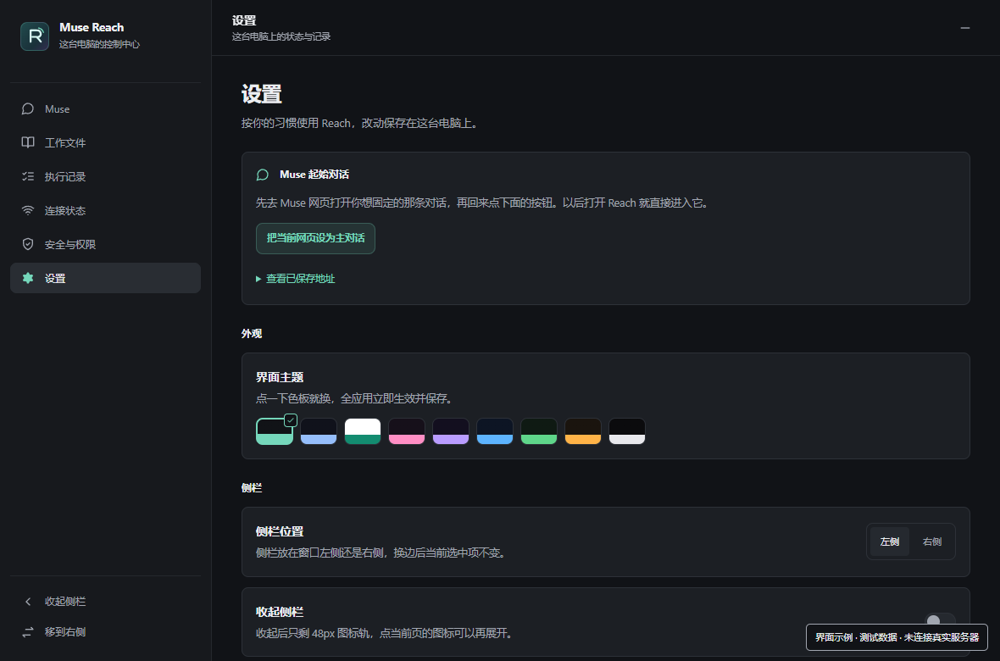
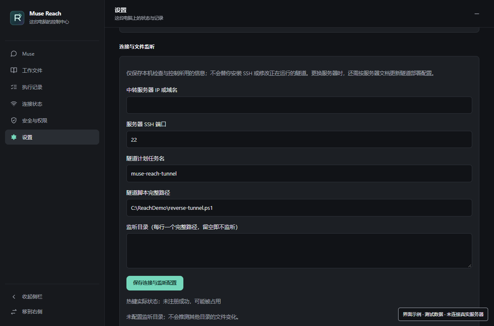

# Muse Reach

**让 Muse 像 Codex 一样，在你自己的电脑上干活。**

Muse Reach 是一个运行在 Windows 上的本地 Agent。接好执行通道后，你可以在 Muse 对话里交代任务，让 Muse 在这台电脑上运行命令、读写文件、修改配置、查看日志，并根据执行结果继续处理。

云端 Muse 负责理解任务和规划步骤，Reach 负责把操作接到本机。你可以像使用 Codex 这类 Agent 一样，把具体工作交给它，再检查它做了什么、文件放在哪里、结果是否符合要求。

## 把电脑上的事交给 Muse

例如，你可以让 Muse：

- **处理本地文件**：读取指定文件，批量修改内容，把生成的脚本和文档保存到你的目录。
- **排查软件问题**：查看报错日志、检查运行环境，修改配置后重新运行验证。
- **开发和运行项目**：在本机项目中执行命令、修改代码、运行测试、构建产物。
- **执行日常脚本**：完成重复的命令行工作，查看退出结果，继续处理失败的步骤。

你可以这样交代任务：

> 看一下这个项目的报错日志，找到原因，修改后再跑一次测试。

> 读取我指定目录里的文件，按要求处理，把结果保存到输出目录。

这些操作发生在你自己的 Windows 电脑上，使用本机的文件、软件环境和 SSH 登录账户权限。

## 从一句任务，到本机执行

1. **在 Muse 里交代任务。** Reach 内嵌 Muse 网页，也可以固定常用对话，下次打开直接继续。
2. **让 Muse 调用本机工具。** 云端经已配置的连接，把命令交给 Windows 上的 Reach 执行器。
3. **在电脑上实际执行。** 执行器运行命令，把输出和退出结果返回云端，供 Muse 判断下一步。
4. **回来看记录和文件。** Reach 展示执行记录、相关文件路径和连接状态，方便你核对结果。

部署时需要为云端 Muse 配置 SSH／命令调用能力，见 [接通本机执行通道](server/README.md)。完成接入后，日常任务通过对话交代；单独打开 Muse 网页不会自动完成这一步配置。

## 干了什么，在哪里，结果如何

Reach 的桌面界面围绕本机工作展开：

- **Muse 对话**：内嵌网页，保存主对话，随时回到任务上下文。
- **执行记录**：查看开始与结束记录、退出结果；没有结束回执时保留未确认状态。
- **工作文件**：汇总记录中关联的文件，一键定位、打开或复制路径；文件移走后仍保留历史。
- **文件变化**：监听你指定的目录，单独列出检测到的变化，便于核对。
- **连接控制**：分层查看本机服务、隧道证据和最近到达记录，按需断开或重建通道。
- **日常使用**：托盘、全局热键、窗口记忆、可收起和换边的侧栏，以及 9 套主题和独立缩放。

## 界面

以下为当前界面的浏览器渲染截图，使用已标注的测试数据。


<details>
<summary>查看连接状态和设置界面</summary>





</details>

## 开始使用

当前版本：**v48 / 0.48.0**。支持 Windows 10 2004 及以上、Windows 11，64 位。

运行环境：.NET 8 Desktop Runtime、WebView2 Runtime。开发构建还需 .NET 8 或更新 SDK、Node.js 20+、Python 3、Windows PowerShell 5.1。

```powershell
dotnet publish source/app/Reach.csproj -c Release -r win-x64 --self-contained false -o out
.\out\MuseReach.exe
```

WebView2 SDK 从微软官方 NuGet 包恢复，固定 `1.0.2903.40`，其依赖锁在 `source/app/packages.lock.json`；不再手工维护仓库 DLL 副本。目标电脑仍需 WebView2 Runtime。

首次打开可以使用网页和控制台；连接页会提示尚未配置。服务器与 Windows SSH 部署见 [server/README.md](server/README.md)。部署脚本需由你明确执行；应用不会自行安装 SSH、修改密钥或防火墙。

在设置页保存的信息用于检查、任务控制及文件监听。服务器或端口变更后，也要更新已部署的 `relay-tunnel.json` 和云端 SSH 配置；保存设置不会悄悄改变正在运行的连接。

运行时数据位于 `%LocalAppData%\MuseReach\`：`settings.json`、`connection.json`、`ops.jsonl`、`reach.log`、`heartbeat.json`、`watch.json`。执行器另用 `requests/` 保存去重标记；部署后增加 `tools/` 和 `tunnel/`。这些文件不进仓库；不要把登录资料、私钥或真实日志上传到公开 issues。

## 开发与验证

```powershell
npm ci
powershell -NoProfile -ExecutionPolicy Bypass -File scripts/check.ps1 -Publish

# 浏览器检查；首次需安装无界面浏览器
npx playwright install chromium
powershell -NoProfile -ExecutionPolicy Bypass -File scripts/check.ps1 -Browser
```

`check.ps1` 遇到任意失败立即返回失败。覆盖三组 C# 逻辑测试、实际 DOM 交互、编码传输、真实本地子进程退出／超时／重复请求／日志失败及 Windows 构建。测试使用临时目录，不连接真实服务器，不改计划任务。`source/tests/ui-v*-checks.cjs` 是保留的历史检查，包含旧版字面量断言，不再作为当前版本验收入口。

GitHub Actions 在 Windows 上构建和测试并提供下载工件；Ubuntu 作 Bash 语法、编码和 OpenSSH 有效配置检查。CI 配置检查不等于你的实际服务器链路已验证。

## 项目结构

```text
source/app/                WinForms、WebView2、本地界面及状态逻辑
source/tests/              设置／几何逻辑、当前 DOM 与浏览器检查、执行器测试
source/baseline-tests/     记录层、探活展示与系统设置逻辑
source/reliability-tests/  配置校验、身份识别、心跳与记账回归
server/                   SSH 身份分离模板、部署与执行器脚本
scripts/check.ps1          当前版本统一验收入口
.github/workflows/         Windows 构建与 Linux 配置检查
```

## 权限与执行记录

Reach 桌面程序不是命令网关，也不是沙箱。云端经 SSH 登录 Windows，拥有该登录账户的实际权限。关闭 Reach 不会停止独立运行的隧道任务。

v48 增加了 `server/Invoke-ReachCommand.ps1`：经它运行的命令先记开始，再记结束和退出码；默认超时 300 秒，允许 1–900 秒；相同请求 ID 不重复执行。初始记账失败时不会启动命令。原始命令默认不写日志，输出仍经 SSH 返回。

**直接 SSH 可以绕过执行器；文件路径与摘要由调用者声明；本机记录可被同账户修改，不能当成防篡改审计证据。** 没有结束记录时只显示等待／未确认，不推断成功。到达记录超过 90 秒仅表示过期，空闲时不会据此宣告假死。界面最多显示最近 5000 个操作，原始账本留在磁盘上；监听变化不代表由 Muse 引起。

完整说明见 [安全边界](SECURITY.md) 和 [服务器部署文档](server/README.md)。

MIT；图标与运行组件的许可见 [THIRD-PARTY-NOTICES.md](THIRD-PARTY-NOTICES.md)。
